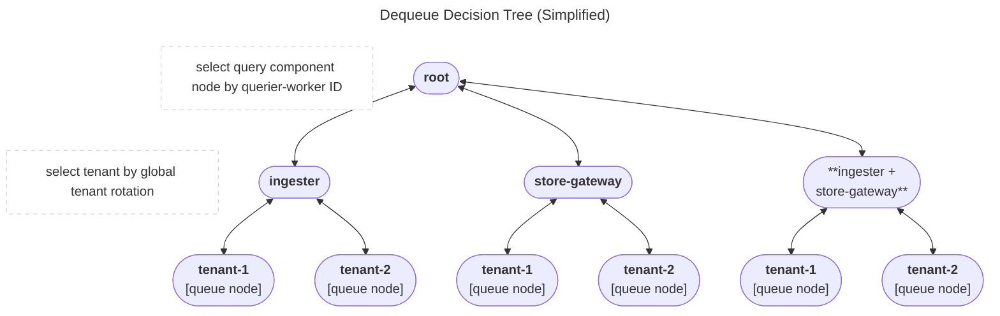
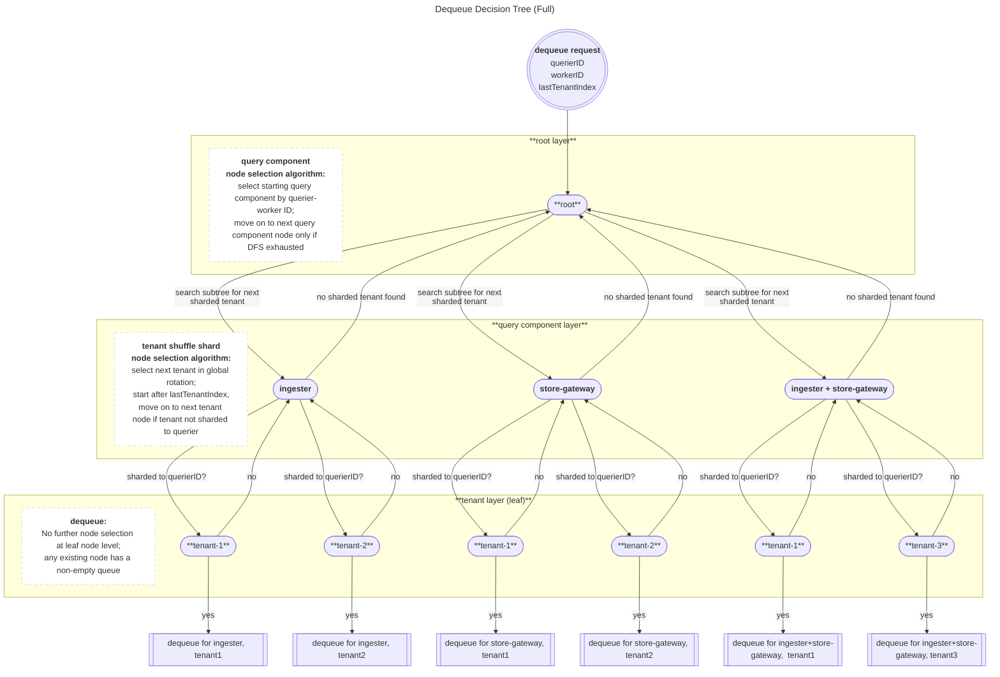
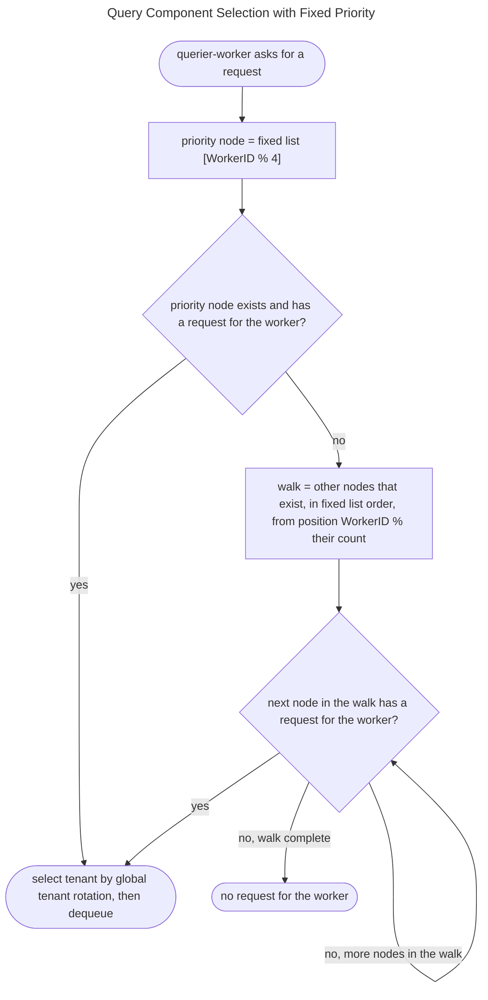
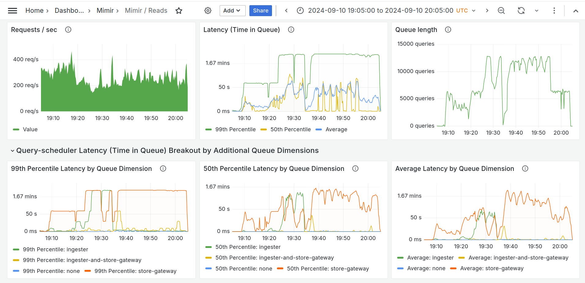

# Query Request Queue Design: Queue Splitting and Prioritization

The scheduler's query request queue is provided by the generic `Queue` (in `pkg/queue`),
wrapped by a thin scheduler-specific `schedulerQueue`.
The wrapper applies the scheduler's queue logic:
it derives the first queue dimension (the query component) from the annotation that the query-frontend attaches to the request,
looks up the per-tenant max-queriers limit from the configured limits,
and owns the `QueryComponentUtilization` tracker.
The `Queue` underneath is responsible for all decisions regarding enqueuing and dequeuing of query requests.

While the `Queue`'s responsibilities are relatively broad, including management of
querier-worker connection lifecycles and graceful startup/shutdown,
the queuing logic is isolated into a "tree queue" structure and its associated queue algorithms.

## Tree Queue: What and Why

The "tree queue" structure serves as a discrete priority queue.
Requests are split into many queues, each of which is located at a leaf node in the tree structure.

The tree structure enables some of the specific requirements of our queue selection algorithms:

1. The system must select a queue to dequeue from based on two independent algorithms, each with their own state:
   1. A query component selection for isolation of query component latency effects
   1. A global tenant rotation for tenant fairness, with configurable shuffle-sharding
1. There is a decision hierarchy between the two queue selection algorithms
   1. For the same inputs, queue selection first by query component, then by tenant
      will often result in a different outcome than queue selection first by tenant, then by query component
   1. In order to effectively isolate query component latency effects,
      the query component selection algorithm must take precedence over tenant rotation
1. The tenant rotation algorithm can reject all queue options presented to it when shuffle-sharding is enabled;
   1. In order to minimize idle querier capacity, the system must be able to
      return up to the query component selection level to continue the search

These requirements lend themselves to a search tree or decision tree structure;
the levels of the tree express a clear hierarchy of decisonmaking between the two algorithms,
and the depth-first traversal provides a familiar pattern for searching for a leaf node to dequeue from.

### Diagram: Dequeue Decision Tree (Simplified)

> [!NOTE]
> The system maintains a fourth query component, `unknown`, which is treated the same as `ingester-and-store-gateway`.
> The `unknown` query component node and its subtree are omitted from diagrams in this doc for simplicity.



### Enqueuing to the Tree Queue

On enqueue, we partition requests into separate queues based on two static properties of the query request:

- the "expected query component", determined by the time range of the query and the Mimir deployment configuration
  - `ingester`, `store-gateway`, `ingester-and-store-gateway`, or `unknown`
- the tenant ID of the request

These properties are used to place the request into a queue at a leaf node.
A request from `tenant-1` which is expected to only utilize ingesters
will be enqueued at the leaf node reached by the path `root -> ingester -> tenant-1`.

This results in `O(m * n)` queues in the tree structure:

- `m` is the number of active query component nodes; `m` is always `<= 4`
- `n` is the number of active tenant nodes; `n` is only bounded by the total active tenant count in a multi-tenant Mimir deployment

### Dequeuing from the Tree Queue

On dequeue, we perform a depth-first search of the tree to select a leaf node to dequeue from.
Each of the two non-leaf levels of the tree uses a different algorithm to select the next child node.

1. At the root node level, one algorithm selects one of four possible query component child nodes.
1. At query component level, the other algorithm attempts to select a tenant-specific child node.
   1. due to tenant-querier shuffle sharding, it is possible that none of the tenant nodes
      can be selected for dequeuing for the current querier.
1. If a tenant node is selected, the search dequeues from it as it has reached a leaf node.
1. If no tenant node is selected, the search returns back up to the root node level
   and selects the next query component child node to continue the search from.

### Diagram: Dequeue Decision Tree (Full)



## Deep Dive: Queue Selection Algorithms

### Context & Requirements

### Original State: Queue Splitting by Tenant

The `Queue` originally utilized only a single dimension of queue splitting, by tenant.
This approach served two purposes:

1. tenant fairness via a simple round-robin between all tenants with non-empty query request queues
1. rudimentary tenant isolation via shuffle-shard assignment of noisy tenants to only a subset of queriers

While this inter-tenant Quality-of-Service approach has worked well,
other QoS issues have arisen from the varying characteristics of Mimir's two "query components":
ingesters and store-gateways, which are called by the queriers to fetch TSDB data for executing queries.

### New Requirement: Isolating Query Component Latency Effects

Ingesters serve requests for recent data, and store-gateways serve requests for older data.
While queries can span the time periods served by both query components,
many requests are served by only one of the two components.

Ingesters and store-gateways tend to experience issues independently of one another,
but when one component was in a degraded state, _all_ queries would wait in the queue behind the slow queries,
causing high latency and timeouts for queries which could have been serviced by the non-degraded query component.

#### Goals

The primary goal of the new design solution is to keep queries which only require the non-degraded query component
moving through the queue and being processed, rather than waiting in the queue behind the slow queries.

#### Non-Goals

In real-world scenarios queries to the degraded query component are often slow enough to hit timeouts,
and the majority of those queries will be expected to fail until the component recovers.
It is not a goal of the new design to solve the problem of latency in the degraded query component,
whether through rate limiting of the queries dequeued to that component or through any other intervention.

#### Constraints

The solution should maintain high utilization of queriers while there are still any requests in the queue.
Querier capacity should not be permanently "reserved" for any query type;
as there is no guarantee of when that query type will be enqueued again,
permanent capacity reservation could result in resource under-utilization and waste.

### Solution 1: Queue Splitting by Query Component and Query Component Selection by Round-Robin

Tenant queues were split again by query component, resulting in up to four queues per tenant.

With queues now split and selected by two dimensions rather than one,
we introduced the "tree queue" structure, inspired by Loki's implementation.

This solution attempted to minimize the complexity of changes:

1. the tenant selection algorithm was kept higher in the tree
   and therefore took priority over the query component queue selection algorithm.
1. the query component selection algorithm was a simple round-robin.

These design decisions resulted in severe limitations in Solution 1's ability to isolate query component latency,
as determined through benchmarks, simulations, and observation in production environments.

#### Limitation 1 (minor): Tenant Selection Priority over Query Component Selection

The fact that the tenant selection was given priority over query-component selection
meant that a tenant's query traffic profile could override the query component round-robin.

If the tenant rotation had selected `tenant-1` which was only sending ingester queries at the time,
the round-robin algorithm could only select the ingester queue from the child queue nodes for `tenant-1`,
overriding the intended progression of the query component round-robin.

#### Limitation 2 (major): Inability to Prevent Processing Time Dominance by Slow Queries

A vanilla round-robin algorithm does not sufficiently guard against a high-latency component
saturating all or nearly all connections with requests in flight in the slow component.
Despite rotating which query component is dequeued for, utilization of the querier-worker connection pool
as measured by inflight query processing time will grow asymptotically to be dominated by the slow query component.

### Solution 2: Query Component Selection to Solve Processing Time Dominance by Slow Queries

Limitation 1 was addressed by inverting the decision hierarchy of the two queue selection algorithms in the tree.

Limitation 2 required more analysis and a new approach to the query component selection.

#### Modeling the Problem

To demonstrate the issue, we simplify the system to two query components and four querier connections.
Queries to the "slow" query component take 8 ticks to process while queries to the "fast" query component take 1 tick.
The round-robin selection advances from fast to slow or vice versa with each dequeue.

In 64 ticks (16 each for 4 connections), the system:

- dequeues and starts processing 16 queries: 8 fast, 8 slow
- completes processing 13 queries: 8 fast, 5 slow
- spends 8 ticks processing the fast queries
- spends 56 ticks processing the slow queries

##### Diagram: Query Processing Time Utilization with Round-Robin

```mermaid
---
title: Query Processing Time Utilization with Round-Robin
config:
  gantt:
    displayMode: compact
    numberSectionStyles: 2
  theme: default
---
gantt
    dateFormat ss
    axisFormat %S
    tickInterval 1second

    section consumer-1
        fast        :active, c1-1, 00, 1s
        fast        :active, c1-2, 01, 1s
        fast        :active, c1-3, 02, 1s
        slow        :done, c1-4, 03, 8s
        slow...     :done, c1-5, 11, 5s

    section consumer-2
        slow        :done, c2-1, 00, 8s
        fast        :active, c2-2, 08, 1s
        fast        :active, c2-3, 09, 1s
        fast        :active, c2-4, 10, 1s
        fast        :active, c2-5, 11, 1s
        slow...     :done, c2-6, 12, 4s

    section consumer-3
        fast        :active, c3-1, 00, 1s
        slow        :done, c3-2, 01, 8s
        slow...     :done, c3-3, 09, 7s

    section consumer-4
        slow        :done, c4-1, 00, 8s
        slow        :done, c4-2, 08, 8s

```



<!--The structure had a simple hashmap mapping tenant IDs to a queue,-->
<!--and rotated through a global list of active tenantIDs.-->
<!--to select the next tenant sharded to the waiting querier.-->

### Solution: Query Component Partitioning by Querier-Worker

This solution is inspired by a research paper from Brown University and Microsoft:
[Two-Dimensional Fair Queuing for Multi-Tenant Cloud Services](https://people.mpi-sws.org/~jcmace/papers/mace20162dfq.pdf).

Querier-worker connections are partitioned evenly across up to four possible query-component nodes
with a modulo of the querier-worker connection ID across the ordered list of nodes.

Ex:
Assume a query component node order of `[ingester, store-gateway, ingester-and-store-gateway, unknown]`.

- querier-worker connection IDs `0`, `4`, `8`, etc. would be assigned to `ingester`
- querier-worker connection IDs `1`, `5`, `9`, etc. would be assigned to `store-gateway`
- etc. for `ingester-and-store-gateway`, and `unknown`

We conservatively expect degradation of the store-gateway query component will cause high latency
for the queries in the `store-gateway`, `ingester-and-store-gateway`, and `unknown` queues,
but by partitioning the querier-worker connections evenly across the four queues,
25% of connections remain "reserved" to process queries from the `ingester` queue.

The primary measure of success is the servicing of the queries to the non-degraded query component,

#### Modeling the Solution

Again we simplify the system to two query components and four querier connections.
Queries to the "slow" query component take 8 ticks to process while queries to the "fast" query component take 1 tick.

In 64 ticks (16 each for 4 connections), the new system:

- dequeues and starts processing 36 queries: 32 fast, 4 slow
- completes processing 36 queries: 32 fast, 4 slow
- spends 32 ticks processing the fast queries
- spends 32 ticks processing the slow queries

Compare with the `Query Processing Time Utilization with Round-Robin` results and diagram above.
The new system allocates more query processing time to the fast queries
and completes 8x more fast queries than the original system in the same time period.

##### Diagram: Query Processing Time Utilization with Querier-Worker Queue Prioritization

```mermaid
---
title: Query Processing Time Utilization with Querier-Worker Queue Prioritization
config:
  gantt:
    displayMode: compact
    numberSectionStyles: 2
  theme: default
---
gantt
    dateFormat ss
    axisFormat %S
    tickInterval 1second

    section consumer-1
        fast        :active, c1-1, 00, 1s
        fast        :active, c1-2, 01, 1s
        fast        :active, c1-3, 02, 1s
        fast        :active, c1-4, 03, 1s
        fast        :active, c1-5, 04, 1s
        fast        :active, c1-6, 05, 1s
        fast        :active, c1-7, 06, 1s
        fast        :active, c1-8, 07, 1s
        fast        :active, c1-9, 08, 1s
        fast        :active, c1-10, 09, 1s
        fast        :active, c1-11, 10, 1s
        fast        :active, c1-12, 11, 1s
        fast        :active, c1-13, 12, 1s
        fast        :active, c1-14, 13, 1s
        fast        :active, c1-15, 14, 1s
        fast        :active, c1-16, 15, 1s

    section consumer-2
        fast        :active, c2-1, 00, 1s
        fast        :active, c2-2, 01, 1s
        fast        :active, c2-3, 02, 1s
        fast        :active, c2-4, 03, 1s
        fast        :active, c2-5, 04, 1s
        fast        :active, c2-6, 05, 1s
        fast        :active, c2-7, 06, 1s
        fast        :active, c2-8, 07, 1s
        fast        :active, c2-9, 08, 1s
        fast        :active, c2-10, 09, 1s
        fast        :active, c2-11, 10, 1s
        fast        :active, c2-12, 11, 1s
        fast        :active, c2-13, 12, 1s
        fast        :active, c2-14, 13, 1s
        fast        :active, c2-15, 14, 1s
        fast        :active, c2-16, 15, 1s


    section consumer-3
        slow        :done, c3-1, 00, 8s
        slow        :done, c3-2, 08, 8s

    section consumer-4
        slow        :done, c4-1, 00, 8s
        slow        :done, c4-2, 08, 8s

```



#### Caveats: Corner Cases and Things to Know

###### Queue Starvation Due to Low `-querier.max-concurrent` Values

If there are fewer than 4 querier-worker connections per querier to the request queue, a query-component
node can be starved of connections.
To prevent this, the querier has been updated to create at least 4 connections to each scheduler,
ignoring any `-querier.max-concurrent` value below 4.

##### Uneven Distribution Querier-Worker Connections Across Query Component Nodes

When the total number of querier-worker connections is not evenly divisible by the number of query component nodes,
the modulo distribution will be uneven, with some nodes being assigned one extra connection.
This is not considered to be an issue.
Queue nodes are deleted as queues are cleared, then recreated in whichever order new queries arrive.
Changes in node count and order over time in turn shuffle which node(s) receive the extra connections.

##### Empty Queue Node Deletion Can Cause Temporary Starvation

As mentioned above, when a queue node is emptied it is deleted from the tree structure
and cannot be selected by the queue selection algorithms.
This can result in the following scenario:

1. Queries to store-gateways are experiencing high latency, causing backup
   in the `store-gateway`, `ingester-and store-gateway`, and `unknown queues`.
2. The ingester-only queries continue to be dequeued and processed by 1/4 of the querier-worker connections.
3. The ingester-only queue is emptied and the `ingester` node is deleted from the tree.
4. The querier-worker connections are now evenly distributed across the remaining three nodes,
   and _all_ connections are now stuck working on slow queries touching the degraded store-gateways.
5. More ingester-only queries arrive and are enqueued at the `ingester` node,
   but no querier-worker connections are available to dequeue them.

This scenario is suboptimal for the goal of processing the ingester-only queries,
but it is considered an acceptable tradeoff against the alternative -
if querier connections were not re-distributed across the query component nodes when the `ingester` node was deleted,
the system would be holding idle querier capacity indefinitely until ingester-only queries were enqueued again.

As soon as the connections which would be partitioned to the `ingester` node become available again,
they will return to working on the ingester-only queries.

Modeling a simplified system again shows that this scenario still improves on the previous state.

If the fast query queue is cleared and deleted before tick 4 and created again after tick 5,
the fast-query queue consumers will have dequeued slow queries at tick 4 and work on them until tick 12.
At tick 12 they return to being dedicated solely to the fast-query queue.

Despite the temporary fast queue starvation, in 64 ticks (16 each for 4 connections), the new system
still dequeues, starts, and completes processing 22 queries (16 fast, 6 slow) -
still 2x more fast queries than the original system in the same time period.

##### Diagram: Temporary Fast Queue Starvation with Querier-Worker Queue Prioritization

```mermaid
---
title: Temporary Fast Queue Starvation with Querier-Worker Queue Prioritization
config:
  gantt:
    displayMode: compact
    numberSectionStyles: 2
  theme: default
---
gantt
    dateFormat ss
    axisFormat %S
    tickInterval 1second

    section consumer-1
        fast        :active, c1-1, 00, 1s
        fast        :active, c1-2, 01, 1s
        fast        :active, c1-3, 02, 1s
        fast        :active, c1-4, 03, 1s
        slow        :done, c1-5, 04, 8s
        fast        :active, c1-6, 12, 1s
        fast        :active, c1-7, 13, 1s
        fast        :active, c1-8, 14, 1s
        fast        :active, c1-9, 15, 1s

    section consumer-2
        fast        :active, c2-1, 00, 1s
        fast        :active, c2-2, 01, 1s
        fast        :active, c2-3, 02, 1s
        fast        :active, c2-4, 03, 1s
        slow        :done, c2-5, 04, 8s
        fast        :active, c2-6, 12, 1s
        fast        :active, c2-7, 13, 1s
        fast        :active, c2-8, 14, 1s
        fast        :active, c2-9, 15, 1s

    section consumer-3
        slow        :done, c3-1, 00, 8s
        slow        :done, c3-2, 08, 8s

    section consumer-4
        slow        :done, c4-1, 00, 8s
        slow        :done, c4-2, 08, 8s

```



### Experimental: Fixed Query Component Priority per Querier-Worker

Set `-query-scheduler.fixed-query-component-priority-enabled=true` to use this algorithm.
It is experimental and disabled by default.

#### Problem: the Worker ID Mapping Changes with the Node Set

The querier-worker partition above maps a worker ID to a position in the order of the query component nodes that exist.
The queue deletes a node when its queue is empty, and adds the node again when a request arrives.
Each deletion and each addition changes the mapping:

- The modulo base changes with the number of nodes.
- A node that the queue adds again goes in at the index of the last dequeue, or at the end of the order.

A fast query component empties its queue often.
So the queue deletes its node and adds it again many times, and the worker IDs that map to it change each time.
A worker that completes a slow request maps to the fast node only when its ID matches the new position.

The `ingester-and-store-gateway` and `unknown` queues can have low request rates.
Their nodes are also deleted and added often, and each change can move the mapping of every worker ID.
The query-frontend puts a request in the `unknown` queue when it does not classify the request path.
Examples are `/api/v1/series`, remote read, exemplar and metadata requests.
[#17184](https://github.com/grafana/mimir/issues/17184) proposes to classify these paths in the query-frontend.
Then fewer requests go to `unknown`, and its node changes less often.

#### Origin: Classes of Service in Networks

The algorithm borrows from class of service in networks.
IEEE 802.1p marks each Ethernet frame with a priority, for example so that a switch puts voice traffic on a VLAN ahead of other traffic.
A Frame Relay circuit has a committed information rate (CIR).
The network also carries traffic above the CIR, up to an excess rate, when it has spare capacity.

| Network                                                    | Query-scheduler with fixed priority                                    |
| ---------------------------------------------------------- | ---------------------------------------------------------------------- |
| Traffic class, marked with an IEEE 802.1p priority         | Query component queue dimension                                        |
| Committed information rate (CIR) of a class                | Priority node of a quarter of the worker IDs                           |
| Traffic above the CIR, when the network has spare capacity | A worker with no request on its priority node walks to the other nodes |
| Packet drops make TCP senders slow down                    | Querier autoscaling adds workers                                       |

The model differs in these ways:

- A CIR is a rate over time, but fixed priority commits a number of workers.
  A worker goes back to its priority node after each request, so the two are close while request times are similar.
- Frame Relay marks traffic above the CIR as discard eligible, and drops it first in congestion.
  Fixed priority drops nothing.
  A worker that walks keeps its request until the request completes.
  So a walk to a slow queue keeps the worker away from its priority node for a long time.
- On slow links, a large frame delayed the small frames behind it.
  Link fragmentation and interleaving, for example FRF.12 for Frame Relay, split large frames so that voice frames could go between the fragments.
  A worker cannot split a request that it has.
  The query-frontend splits and shards queries before they reach the queue, but a slow query component makes every request to it slow.
- The per-tenant queue limit still rejects requests when the queue of a tenant is full.

#### Algorithm

The worker ID modulo 4 gives each querier-worker connection a fixed priority node from the fixed list
`[ingester, store-gateway, ingester-and-store-gateway, unknown]`.
The mapping does not depend on which nodes exist.
So it does not change when the queue deletes or adds a node.

1. The worker dequeues from its priority node first.
1. When its priority node does not exist, or has no request for the worker, the worker walks over the other nodes that exist.
1. The walk takes the other nodes in the order of the fixed list, from position `WorkerID % <number of other nodes>`.
1. For its next request, the worker starts at its priority node again.

The walk depends only on the worker ID and on the nodes that exist.
Workers share no walk state.

##### Diagram: Query Component Selection with Fixed Priority



##### Example: Worker IDs That Try the Ingester Node First

Assume that the store-gateways are slow.
The worker IDs are those of one querier with 4 connections to this query-scheduler.
The `store-gateway` and `ingester-and-store-gateway` queues have a backlog, and the `unknown` queue is empty.
The `ingester` queue empties and gets new requests many times.

| Nodes that exist, in node order                                                    | Worker IDs that try `ingester` first, today | Worker IDs that try `ingester` first, fixed priority |
| ---------------------------------------------------------------------------------- | ------------------------------------------- | ---------------------------------------------------- |
| `ingester`, `store-gateway`, `ingester-and-store-gateway`                          | 0, 3                                        | 0, 3                                                 |
| `store-gateway`, `ingester-and-store-gateway` (the `ingester` queue is empty)      | none                                        | none                                                 |
| `store-gateway`, `ingester`, `ingester-and-store-gateway` (`ingester` added again) | 1                                           | 0, 3                                                 |
| `store-gateway`, `ingester-and-store-gateway`, `ingester` (`ingester` added again) | 2                                           | 0, 3                                                 |

With fixed priority, worker 0 has `ingester` as its priority node.
Worker 3 has `unknown` as its priority node.
That node does not exist, so worker 3 walks, and its walk starts at `ingester`.
Today, after the queue adds `ingester` again, the worker IDs that map to it depend on the index of the last dequeue.
Those workers can hold slow requests for many seconds.

##### Cost of a Dequeue

The tree deletes an empty node, so a check of an empty priority node is one map lookup.
Fixed priority also builds the walk order on each dequeue.
`BenchmarkConsumerWorkerFixedPriorityAlgo_Dequeue` in `pkg/queue/tree` measures the time per dequeue for one worker.
These are the ranges of 3 runs of 200,000 dequeues each, on a 10-core arm64 machine:

| Priority node                                      | Today                        | Fixed priority                   |
| -------------------------------------------------- | ---------------------------- | -------------------------------- |
| Empty, so the queue deleted it                     | 0.29 to 0.66 µs              | 0.35 to 0.46 µs                  |
| Has requests                                       | 0.64 µs                      | 0.36 to 0.44 µs                  |
| Holds only tenants of other queriers, 1000 tenants | 114 to 117 µs, finds nothing | 48 µs, walks and finds a request |

Fixed priority is not slower than today for an empty node or for a node with requests.
Both times are small next to the time that a querier takes for a request.
With querier shuffle sharding, the costly case is a node that holds only tenants of other queriers.
The tenant algorithm then scans the shared tenant order, so the cost grows with the number of queued tenants.
That cost is also on main.

If the tree kept empty nodes, fixed priority would behave the same, because a worker would find its priority node empty and walk.
A kept empty node adds one step to each walk that reaches it: the tree enters the node and returns at its `IsEmpty()` check.
That step is not measured.
The tree would also need an item count.
`IsEmpty()` is non-recursive only while the tree deletes empty nodes, and the dispatcher loop in `pkg/queue/queue.go` runs while the tree is not empty.
Without an item count, kept empty nodes would make the dispatcher try dequeues that find nothing.
Today's algorithm with kept empty nodes would keep its mapping, but a worker that maps to an empty node would get no request.
It would need a walk, and a fixed node order with a walk is fixed priority.
So fixed priority keeps the deletion.

#### Simulation

The simulation runs the real `Queue` code with fake time (`testing/synctest`).
Requests for each query component arrive as a Poisson process.
Each querier has 4 workers.
The values below are for this simulation only.
The test `TestQueueSimulation_FixedPriorityQueueDimensions` in `pkg/queue/queue_simulation_test.go` runs the simulation when the environment variable `MIMIR_QUEUE_SIMULATION` is `true`.
Set `MIMIR_QUEUE_SIMULATION_SEEDS=10` for 10 runs, and `MIMIR_QUEUE_SIMULATION_QUERIERS=64` for 256 workers.

| Query component              | Requests per second | Normal request time      | Slow request time   |
| ---------------------------- | ------------------- | ------------------------ | ------------------- |
| `ingester`                   | 800                 | exponential, mean 50 ms  | uniform, 10 to 40 s |
| `store-gateway`              | 40                  | exponential, mean 200 ms | uniform, 10 to 40 s |
| `ingester-and-store-gateway` | 20                  | exponential, mean 200 ms | uniform, 10 to 40 s |
| `unknown`                    | 5                   | exponential, mean 100 ms | uniform, 10 to 40 s |

Each run lasts 120 s of fake time.
The results ignore the requests of the first 30 s.
Each value is the mean of 10 runs with different seeds.
The results of today's algorithm vary more from run to run than the results of fixed priority.
Arrivals do not slow down when a queue grows.
So a slow queue grows for the whole run, and the tables show `backlog` for its wait.
In production, querier autoscaling adds workers, the fast queues drain, and the free workers then help to burn down the slow queue.
Slow queries can also stop, for example when they complete, time out or the client cancels them.
The simulation does not model either effect.

Mean queue wait with 128 workers.
I is `ingester`, SG is `store-gateway`, I+SG is `ingester-and-store-gateway` and U is `unknown`.

| Slow queues    | Today, I | Today, SG | Today, I+SG | Today, U | Fixed, I | Fixed, SG | Fixed, I+SG | Fixed, U |
| -------------- | -------- | --------- | ----------- | -------- | -------- | --------- | ----------- | -------- |
| I and I+SG     | backlog  | 6.16 s    | backlog     | 0.38 s   | backlog  | 1.13 s    | backlog     | 0.80 s   |
| SG and I+SG    | 17.9 s   | backlog   | backlog     | 0.60 s   | 2.90 s   | backlog   | backlog     | 0.002 s  |
| I, SG and I+SG | backlog  | backlog   | backlog     | 0.73 s   | backlog  | backlog   | backlog     | 0.73 s   |
| I+SG only      | 11.5 s   | 2.48 s    | backlog     | 0.06 s   | 16.4 s   | 1.20 s    | backlog     | 0.12 s   |
| U only         | 13.0 s   | 2.16 s    | 0.83 s      | backlog  | 19.7 s   | 0.54 s    | 0.68 s      | backlog  |

Queue wait of the fast query component that each case puts at risk.
The range of the run means is in brackets.

| Slow queues | Wait of | Workers | Today, mean           | Today, p99 | Fixed priority, mean  | Fixed priority, p99 |
| ----------- | ------- | ------- | --------------------- | ---------- | --------------------- | ------------------- |
| I and I+SG  | SG      | 128     | 6.16 s (1.40 to 22.8) | 15.6 s     | 1.13 s (0.84 to 1.58) | 3.66 s              |
| I and I+SG  | SG      | 256     | 3.25 s (0.96 to 5.49) | 10.3 s     | 0.42 s (0.31 to 0.48) | 1.55 s              |
| SG and I+SG | I       | 128     | 17.9 s (11.0 to 26.5) | 36.2 s     | 2.90 s (2.15 to 4.52) | 10.1 s              |
| SG and I+SG | I       | 256     | 4.97 s (1.82 to 13.4) | 10.8 s     | 0.33 s (0.22 to 0.60) | 1.62 s              |
| I+SG only   | I       | 128     | 11.5 s (6.00 to 18.8) | 14.9 s     | 16.4 s (13.7 to 19.8) | 21.4 s              |
| I+SG only   | I       | 256     | 3.28 s (2.03 to 4.41) | 8.44 s     | 0.81 s (0.41 to 1.26) | 4.86 s              |
| U only      | I       | 128     | 13.0 s (9.37 to 17.2) | 16.8 s     | 19.7 s (17.0 to 22.0) | 26.2 s              |
| U only      | I       | 256     | 0 s                   | 0 s        | 0 s                   | 0 s                 |

Slow requests served from 30 s to 120 s with 128 workers:

| Slow queues | Requests of     | Today | Fixed priority |
| ----------- | --------------- | ----- | -------------- |
| I and I+SG  | `ingester`      | 251   | 227            |
| SG and I+SG | `store-gateway` | 202   | 154            |

The `store-gateway` needs few workers: 40 requests per second at 200 ms keep about 8 workers busy.
A quarter of the workers have `store-gateway` as their priority node.
So the order of the walk has little effect on the `store-gateway` wait.
The `ingester` needs about 40 busy workers.
With 128 workers, that is more than its quarter, so it also needs the workers that walk to it.

When only the `ingester-and-store-gateway` queue or only the `unknown` queue is slow, the walk start can send those workers to the slow queue first.
For example, the `store-gateway` queue empties often.
Worker 3 then sees only `ingester` and `ingester-and-store-gateway`, and its walk starts at `ingester-and-store-gateway`.
With 128 workers, the `ingester` wait is then longer than today.
With 256 workers, the `ingester` needs less than its quarter, and fixed priority is better than or equal to today in all cases.
Querier autoscaling adds these workers, see Querier Autoscaling.
A growing `ingester` queue also drives querier autoscaling.
The Mimir jsonnet scales queriers on `cortex_query_scheduler_inflight_requests`, which counts the queued requests.

More workers stay on the fast queues, so fixed priority completes fewer slow requests in the run.

Across query components, neither algorithm serves requests in enqueue order.
A later request can go ahead of an earlier request to another query component.
This happens when the next free worker tries the later request's query component first.
With fixed priority, that worker is a priority worker of that query component, or a worker that walks to it first.

##### Workers per Querier

The regression depends on how many workers have `ingester` as their priority node.
With 5 workers per querier, workers 0 and 4 have `ingester` as their priority node.
With 6, workers 0 and 4 have `ingester`, and workers 1 and 5 have `store-gateway`.
Set `MIMIR_QUEUE_SIMULATION_WORKERS_PER_QUERIER=5` and `MIMIR_QUEUE_SIMULATION_QUERIERS=26` for 130 workers.
Set `MIMIR_QUEUE_SIMULATION_WORKERS_PER_QUERIER=6` and `MIMIR_QUEUE_SIMULATION_QUERIERS=21` for 126 workers.

`ingester` queue wait with 126 to 130 workers, mean of 10 runs, range of the run means in brackets:

| Slow queues | Today, 4 per querier  | Fixed, 4 per querier  | Today, 5 per querier  | Fixed, 5 per querier  | Today, 6 per querier  | Fixed, 6 per querier  |
| ----------- | --------------------- | --------------------- | --------------------- | --------------------- | --------------------- | --------------------- |
| I+SG only   | 10.6 s (6.10 to 18.4) | 16.4 s (12.2 to 19.8) | 20.2 s (8.31 to 30.9) | 0.76 s (0.20 to 2.28) | 38.2 s (35.6 to 42.6) | 6.14 s (2.98 to 8.69) |
| U only      | 14.6 s (9.65 to 18.8) | 19.9 s (17.2 to 24.1) | 14.2 s (10.4 to 18.2) | 1.27 s (0.34 to 2.98) | 25.3 s (21.4 to 27.3) | 5.34 s (2.67 to 6.72) |

With 6 workers per querier, `unknown` has 1 priority worker of 6.
When `ingester`, `store-gateway` and `ingester-and-store-gateway` are all slow, the `unknown` wait is then 1.28 s (0.98 to 2.21), against 1.07 s (0.81 to 1.25) today.

##### Querier Autoscaling

Set `MIMIR_QUEUE_SIMULATION_SCALE_TO_QUERIERS=64` to start 32 more queriers at 60 s, as querier autoscaling does.
`MIMIR_QUEUE_SIMULATION_SCALE_AT_SECONDS` sets the time.
These runs last 180 s, with `MIMIR_QUEUE_SIMULATION_HORIZON_SECONDS=180`.
The simulation logs the mean queue wait by 10 s window of arrival time.

The table gives the queue wait of the fast query component that each case puts at risk, by arrival time.
The runs start with 128 workers and have 256 workers from 60 s.
The values are the mean of 5 runs:

| Slow queues    | Wait of | Today, 30 to 60 s | Today, 60 to 90 s | Today, 90 to 120 s | Today, 150 to 180 s | Fixed, 30 to 60 s | Fixed, 60 to 90 s | Fixed, 90 to 120 s | Fixed, 150 to 180 s |
| -------------- | ------- | ----------------- | ----------------- | ------------------ | ------------------- | ----------------- | ----------------- | ------------------ | ------------------- |
| SG and I+SG    | I       | 7.66 s            | 8.95 s            | 6.77 s             | 11.6 s              | 4.43 s            | 0.54 s            | 0.27 s             | 0.19 s              |
| I and I+SG     | SG      | 2.63 s            | 3.49 s            | 2.97 s             | 3.08 s              | 0.61 s            | 0.61 s            | 0.50 s             | 0.39 s              |
| I, SG and I+SG | U       | 0.66 s            | 0.54 s            | 0.37 s             | 0.44 s              | 0.70 s            | 0.57 s            | 0.34 s             | 0.39 s              |
| I+SG only      | I       | 9.36 s            | 7.31 s            | 3.26 s             | 0.87 s              | 11.6 s            | 2.69 s            | 0.45 s             | 0.24 s              |
| U only         | I       | 10.1 s            | 1.20 s            | 0 s                | 0 s                 | 11.1 s            | 1.58 s            | 0 s                | 0 s                 |

After the scale-up, fixed priority drains the fast queue faster than today, except when only `unknown` is slow.
With today's algorithm and slow store-gateways, the `ingester` wait stays above 6 s until the end of the run.

In the `flood` scenario, every arrival rate is 3 times higher from 30 s for 30 s, and no request is slow.
With 128 workers, the `ingester` wait was 3.05 s at the mean and 7.58 s at p99 with both algorithms.
With 256 workers, no request waited.
The simulation does not use querier shuffle sharding.
Without it, both algorithms keep every worker busy while any queue has work.
So a flood with no slow query component gives the same wait.

The unit test `TestQueue_FixedPriorityQueueDimensions_FastQueueWaitWhileOtherQueryComponentIsSlow` runs a small version of both cases.
It logs the mean wait of the fast query component for both algorithms.
It does not compare them, because the means change from run to run.

#### Alternatives Considered

- **One walk position for all workers.**
  The position moved past each node that a walk dequeued from.
  So a worker that walked from the fast node often went to a slow node.
  A prototype of this walk is not in the repository.
  In the unit test with 2 nodes, the prototype made the fast queue wait 3 to 5 times longer than today.
- **One walk cursor per worker.**
  The cursor moved past each node that the worker walked to, so the worker took one request from each node in turn.
  That gives each node an equal number of requests.
  It does not give each node an equal time.
  A worker that takes one 50 ms request and then one 25 s request spends almost all its time on the slow node.
  A prototype of this walk is not in the repository.
  In the simulation with slow store-gateways and 128 workers, the prototype made the mean `ingester` wait about 2 times the mean of today's algorithm.
- **A walk that always tries `ingester` first.**
  This gives the most workers to the `ingester` when the store-gateways are slow.
  When the ingesters are slow, every worker that walks goes to the slow `ingester` first.
  The `ingester-and-store-gateway` queue then gets only the workers that have it as their priority node.

#### Caveats

- The walk start depends on the number of other nodes that exist.
  In the example, worker 3 walks to `ingester` first because 3 other nodes exist.
  With 2 other nodes, worker 3 walks to the second of them first.
  The same walk start makes the `ingester` wait longer when only `ingester-and-store-gateway` or only `unknown` is slow, see Simulation.
- A worker still leaves its priority node when that node has no request at the time of the dequeue.
  The worker can then hold a slow request for a long time.
  Fixed priority makes the worker go back to its priority node after that request.
  It does not keep the worker on the node.
- With querier shuffle sharding, a node can hold only tenants of other queriers.
  Today's algorithm then dequeues nothing for the worker, even when another node has a request for its querier.
  Fixed priority walks to the other nodes.
  So with shuffle sharding, fixed priority also keeps more workers busy.
  The simulation does not measure this.
- A queue dimension that is not in the fixed list is the priority node of no worker.
  Workers dequeue from it only in a walk.
  While the other queues have a backlog, a walk finds a request before it reaches that queue, so the queue can starve.
- With ingest storage, a request with strong read consistency waits in the ingester.
  The ingester waits until it consumes up to the offsets in the request, or up to the last produced offset.
  Then it runs the request.
  The ingester does this in `enforceReadConsistency` in `pkg/ingester/ingester_query.go`.
  The query-frontend picks the queue dimension from the request path and time range only.
  So these requests are in the `ingester`, `ingester-and-store-gateway` and `unknown` queues.
  For example, series requests and remote read requests are in the `unknown` queue.
  When ingesters lag, slow strong-consistency requests and fast eventual requests are in the same queues, and fixed priority does not separate them.
  The `store-gateway` queue keeps its priority workers.
  A separate strong-consistency queue dimension needs its own priority node, because a queue that only walks reach can starve.

### Benchmarks and Simulation

Solutions 1 and 2 were tested using both Go benchmarks and simulation in a live Mimir cluster.

The measure of comparison is the time spent in queue by the queries for the non-degraded query component.
All test scenarios slowed down the store-gateway queries and measured the time spent in queue by ingester-only queries.

#### Simulation in a Live Cluster with Load Generation

A 60-minute simulation was run with the following parameters:

- 10k queries per second, split 50 / 50 between ingesters and store-gateways
- 10-second artificial slowdown in the store-gateways created with a sleep in the `Series` method
- start at 19:05
- complete at 20:05
- scheduler restarted to enable the new queue selection algorithm at the midpoint, 19:35

Before 19:35, the queue latency for ingester-only queries approached that of the store-gateway queries.

As the queue backed up, both queries for all query components had:

- 99th percentile time in queue near 2 minutes
- 50th percentile time in queue over 1 minute

After the Solution 2 configuration was enabled at 19:35, ingester-only queries were able to be dequeued and processed
independently of the store-gateway queries, and queue latency for the ingester-only queries dropped significantly.

While queue latency for store-gateway queries remained steadily high, ingester-only queries had:

- 99th percentile time in queue around 2 seconds
- 50th percentile time in queue around 200 ms

The Mimir / Reads dashboard sections for the Query Scheduler illustrate the impact of Solution 2:



#### Benchmarks with Go Tests

A unit-test-based benchmark `TestMultiDimensionalQueueAlgorithmSlowConsumerEffects` was created
for more controlled simulation and comparison of the Solutions 1 and 2.

The unit test approach allows for benchmarking of:

- single-tenant and multi-tenant scenarios
- varying distributions of requests between fast and slow query components
- tenant-querier shuffle sharding

The benchmark results showed that Solution 2 massively outperformed Solution 1.

Improvements for queue latency for the ingester-only queries range
from around 5x improvement for scenarios with lower percentages of slow queries to the store-gateways,
up to over 40x improvement for scenarios with high percentages of slow queries to the store-gateways.

##### Sample Benchmark Results

Results for the test scenarios are shown twice, once by query component and once by tenant ID.
The `tenant-querier -> query component round-robin tree` is Solution 1
and the `worker-queue prioritization -> tenant-querier tree` Solution 2.

```text
Results by query component:
tree: tenant-querier -> query component round-robin tree, 1 tenant, 10pct slow queries: seconds in queue: [ingester: mean: 0.1046 stddev: 0.02 store-gateway: mean: 0.0079 stddev: 0.02]
tree: worker-queue prioritization -> tenant-querier tree, 1 tenant, 10pct slow queries: seconds in queue: [ingester: mean: 0.0194 stddev: 0.01 store-gateway: mean: 0.0271 stddev: 0.04]
tree: tenant-querier -> query component round-robin tree, 1 tenant, 25pct slow queries: seconds in queue: [ingester: mean: 0.2738 stddev: 0.08 store-gateway: mean: 0.1084 stddev: 0.09]
tree: worker-queue prioritization -> tenant-querier tree, 1 tenant, 25pct slow queries: seconds in queue: [ingester: mean: 0.0159 stddev: 0.01 store-gateway: mean: 0.1177 stddev: 0.09]
tree: tenant-querier -> query component round-robin tree, 1 tenant, 50pct slow queries: seconds in queue: [ingester: mean: 0.3894 stddev: 0.18 store-gateway: mean: 0.2471 stddev: 0.17]
tree: worker-queue prioritization -> tenant-querier tree, 1 tenant, 50pct slow queries: seconds in queue: [ingester: mean: 0.0118 stddev: 0.01 store-gateway: mean: 0.2530 stddev: 0.17]
tree: tenant-querier -> query component round-robin tree, 1 tenant, 75pct slow queries: seconds in queue: [ingester: mean: 0.2608 stddev: 0.18 store-gateway: mean: 0.3999 stddev: 0.26]
tree: worker-queue prioritization -> tenant-querier tree, 1 tenant, 75pct slow queries: seconds in queue: [ingester: mean: 0.0053 stddev: 0.00 store-gateway: mean: 0.4056 stddev: 0.26]
tree: tenant-querier -> query component round-robin tree, 1 tenant, 90pct slow queries: seconds in queue: [ingester: mean: 0.0780 stddev: 0.07 store-gateway: mean: 0.4917 stddev: 0.31]
tree: worker-queue prioritization -> tenant-querier tree, 1 tenant, 90pct slow queries: seconds in queue: [ingester: mean: 0.0026 stddev: 0.00 store-gateway: mean: 0.4929 stddev: 0.31]
tree: tenant-querier -> query component round-robin tree, 2 tenants, first with 10pct slow queries, second with 90pct slow queries: seconds in queue: [ingester: mean: 0.1099 stddev: 0.04 store-gateway: mean: 0.2333 stddev: 0.17]
tree: worker-queue prioritization -> tenant-querier tree, 2 tenants, first with 10pct slow queries, second with 90pct slow queries: seconds in queue: [ingester: mean: 0.0114 stddev: 0.00 store-gateway: mean: 0.2644 stddev: 0.18]
tree: tenant-querier -> query component round-robin tree, 2 tenants, first with 25pct slow queries, second with 75pct slow queries: seconds in queue: [ingester: mean: 0.2402 stddev: 0.10 store-gateway: mean: 0.2277 stddev: 0.16]
tree: worker-queue prioritization -> tenant-querier tree, 2 tenants, first with 25pct slow queries, second with 75pct slow queries: seconds in queue: [ingester: mean: 0.0101 stddev: 0.00 store-gateway: mean: 0.2447 stddev: 0.17]
tree: tenant-querier -> query component round-robin tree, 2 tenants, first with 50pct slow queries, second with 50pct slow queries: seconds in queue: [ingester: mean: 0.3586 stddev: 0.18 store-gateway: mean: 0.2149 stddev: 0.15]
tree: worker-queue prioritization -> tenant-querier tree, 2 tenants, first with 50pct slow queries, second with 50pct slow queries: seconds in queue: [ingester: mean: 0.0106 stddev: 0.01 store-gateway: mean: 0.2113 stddev: 0.15]

Results for ingester-only queries by tenant ID:
tree: tenant-querier -> query component round-robin tree, 1 tenant, 10pct slow queries: seconds in queue:[tenant-0: mean: 0.1046 stddev: 0.02]
tree: worker-queue prioritization -> tenant-querier tree, 1 tenant, 10pct slow queries: seconds in queue:[tenant-0: mean: 0.0194 stddev: 0.01]
tree: tenant-querier -> query component round-robin tree, 1 tenant, 25pct slow queries: seconds in queue:[tenant-0: mean: 0.2738 stddev: 0.08]
tree: worker-queue prioritization -> tenant-querier tree, 1 tenant, 25pct slow queries: seconds in queue:[tenant-0: mean: 0.0159 stddev: 0.01]
tree: tenant-querier -> query component round-robin tree, 1 tenant, 50pct slow queries: seconds in queue:[tenant-0: mean: 0.3894 stddev: 0.18]
tree: worker-queue prioritization -> tenant-querier tree, 1 tenant, 50pct slow queries: seconds in queue:[tenant-0: mean: 0.0118 stddev: 0.01]
tree: tenant-querier -> query component round-robin tree, 1 tenant, 75pct slow queries: seconds in queue:[tenant-0: mean: 0.2608 stddev: 0.18]
tree: worker-queue prioritization -> tenant-querier tree, 1 tenant, 75pct slow queries: seconds in queue:[tenant-0: mean: 0.0053 stddev: 0.00]
tree: tenant-querier -> query component round-robin tree, 1 tenant, 90pct slow queries: seconds in queue:[tenant-0: mean: 0.0780 stddev: 0.07]
tree: worker-queue prioritization -> tenant-querier tree, 1 tenant, 90pct slow queries: seconds in queue:[tenant-0: mean: 0.0026 stddev: 0.00]
tree: tenant-querier -> query component round-robin tree, 2 tenants, first with 10pct slow queries, second with 90pct slow queries: seconds in queue:[tenant-0: mean: 0.1183 stddev: 0.02 tenant-1: mean: 0.0415 stddev: 0.05]
tree: worker-queue prioritization -> tenant-querier tree, 2 tenants, first with 10pct slow queries, second with 90pct slow queries: seconds in queue:[tenant-0: mean: 0.0123 stddev: 0.00 tenant-1: mean: 0.0040 stddev: 0.00]
tree: tenant-querier -> query component round-robin tree, 2 tenants, first with 25pct slow queries, second with 75pct slow queries: seconds in queue:[tenant-0: mean: 0.2639 stddev: 0.08 tenant-1: mean: 0.1662 stddev: 0.12]
tree: worker-queue prioritization -> tenant-querier tree, 2 tenants, first with 25pct slow queries, second with 75pct slow queries: seconds in queue:[tenant-0: mean: 0.0118 stddev: 0.00 tenant-1: mean: 0.0047 stddev: 0.00]
tree: tenant-querier -> query component round-robin tree, 2 tenants, first with 50pct slow queries, second with 50pct slow queries: seconds in queue:[tenant-0: mean: 0.3724 stddev: 0.17 tenant-1: mean: 0.3452 stddev: 0.19]
tree: worker-queue prioritization -> tenant-querier tree, 2 tenants, first with 50pct slow queries, second with 50pct slow queries: seconds in queue:[tenant-0: mean: 0.0104 stddev: 0.01 tenant-1: mean: 0.0109 stddev: 0.00]

```
